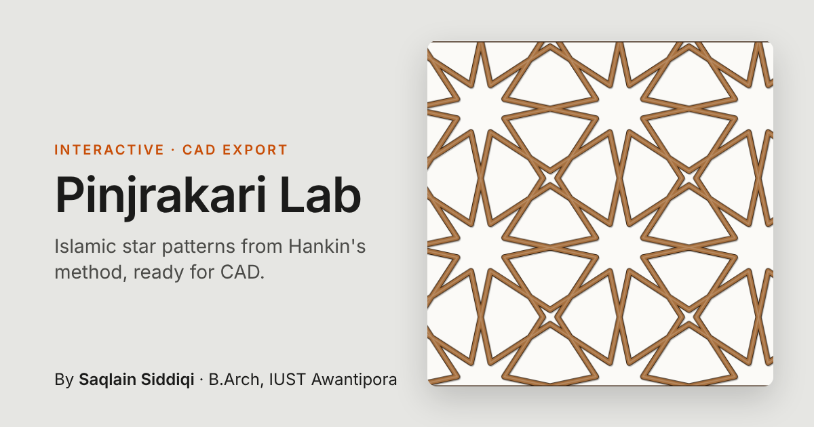

# Pinjrakari Lab

**Live:** https://siddiqisaqlain.github.io/pinjrakari-lab/

An interactive Islamic star pattern generator, inspired by the geometric woodwork of Kashmir.
Pick a base tiling, turn the contact-angle dial, and export a real-scale drawing for CAD.

## What it does

- **Six base tilings:** square, triangle, hexagon, 4.8.8, 3.6.3.6 and 3.12.12, with starter presets such as the eight-point and twelve-point stars.
- **Contact-angle dial:** one control, from 5° to 85°, sets how open or tight the stars become.
- **Step-by-step construction:** view the tiling, the edge midpoints, the rays, the trim and the finished pattern in turn.
- **Attractor:** bends the angle around a point you drag, so a single pattern can vary across a panel.
- **Strapwork view:** draws the lines as wooden strips, the way a pinjrakari screen reads.
- **Real-scale export:** DXF, SVG and PNG at the tile and panel size you set, in millimetres.

## How it works

The patterns use Hankin's polygons-in-contact method. Start from a tiling of regular polygons, place two rays at the midpoint of every edge, tilted by the contact angle, and trim each ray where it meets its neighbour. What remains is the star pattern.

## Context

- **Pinjrakari:** Kashmiri lattice screens, made from small pieces of wood fitted together.
- **Khatamband:** Kashmiri ceilings made of small interlocking wooden pieces that form geometric patterns. The eight-point and twelve-point presets belong to the same family of geometry.

## Using the exports

- **DXF:** unzip the download. Units are millimetres (1 drawing unit = 1 mm). Layers: `PATTERN`, `TILING`, `PANEL`, `TITLE`. Opens in AutoCAD, Rhino, Fusion and LibreCAD.
- **SVG:** millimetre sizes. Opens in Illustrator, Inkscape and Figma, and works in laser-cutting workflows.
- **PNG:** 2400 px, with a title strip.

## Run locally

It is a single static page with no build step and no dependencies. Open `index.html`, or run `python3 -m http.server` in this folder and visit http://localhost:8000.

## Credits

- Method: Hankin's polygons-in-contact technique, as described by Craig S. Kaplan.
- Algorithmic control of the patterns: Lee, Kim and Jeon, summarised on [Parametric House](https://parametrichouse.com/the-islamic-star-pattern/).

## Author

**Saqlain Siddiqi**, B.Arch student, IUST Awantipora, Kashmir · [LinkedIn](https://linkedin.com/in/saqlain-siddiqi)

## Licence

[MIT](LICENSE) © 2026 Saqlain Siddiqi
